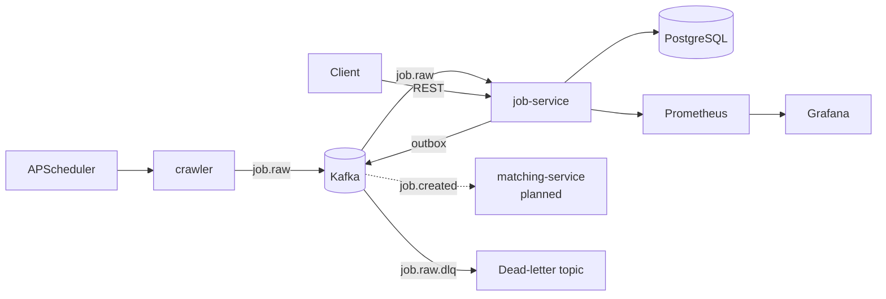

# job-hunter


An event-driven microservice system that collects, normalizes and indexes job postings, built with Python, Kafka and PostgreSQL.

## Architecture



| Service | Responsibility |
|---|---|
| crawler | Fetches postings on a schedule and publishes them, almost unmodified, to `job.raw` |
| job-service | Normalizes (salary, skills), deduplicates across sources, stores, serves the search API, publishes `job.created` |
| matching-service | *(planned)* Matches jobs against user criteria |
| notification-service | *(planned)* Notifies users about matching jobs |

## Key engineering points

- **Event-driven with Kafka (KRaft):** the crawler and job-service are decoupled. `job.raw` can be replayed to reprocess data after changing normalization logic.
- **Transactional Outbox:** a job and its `job.created` event are written in one transaction, so events are never lost when Kafka is unavailable (at-least-once delivery).
- **Cross-source deduplication:** the same job from several sources is stored once; its origins live in `job_sources`.
- **Dead-letter topic:** failing messages are retried a limited number of times, then moved to `job.raw.dlq` with the error and original position in headers.
- **Observability:** Prometheus metrics and a Grafana dashboard provisioned from files.
- **Versioned migrations:** Alembic.
- **CI:** GitHub Actions runs tests and builds images for every service.

## Getting started

Requirements: Docker and Docker Compose.

```bash
git clone git@github.com:ten-cua-ban/job-hunter.git
cd job-hunter
docker compose up -d --build

# create topics (first run only)
for t in job.raw job.created; do
  docker compose exec kafka /opt/kafka/bin/kafka-topics.sh --create --topic $t \
    --partitions 3 --replication-factor 1 --bootstrap-server kafka:9092
done
docker compose exec kafka /opt/kafka/bin/kafka-topics.sh --create --topic job.raw.dlq \
  --partitions 1 --replication-factor 1 --bootstrap-server kafka:9092
```

| Component | URL |
|---|---|
| API + Swagger UI | http://localhost:8000/docs |
| Kafka UI | http://localhost:8080 |
| Prometheus | http://localhost:9090 |
| Grafana (admin / admin) | http://localhost:3000 |

Example API calls:

```bash
curl "localhost:8000/jobs?q=python&skills=docker&limit=5"
curl "localhost:8000/jobs?min_salary=100000&currency=USD"
```

## Tests

```bash
docker compose run --rm -v "$PWD/services/job-service":/srv job-service \
  sh -c "pip install -q -r requirements-dev.txt && pytest -v"
```

## Design decisions

- [ADR-0001: Kafka over RabbitMQ](docs/adr/0001-kafka-over-rabbitmq.md)
- [ADR-0002: Transactional Outbox](docs/adr/0002-transactional-outbox.md)

## Known limitations and roadmap

- Only one data source (RemoteOK) so far. A new source is a single new file in `services/crawler/app/sources/`.
- Full-text search uses the `simple` configuration and is not accent-insensitive, so Vietnamese text is only partially supported.
- No replay tooling for the dead-letter topic yet.
- Planned: user-service, matching-service, notification-service, Kubernetes deployment.
