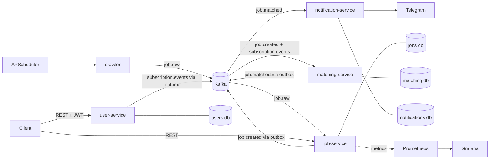

# job-hunter


An event-driven microservice system that collects job postings, normalizes and deduplicates them, matches them against user subscriptions and delivers notifications over Telegram. Built with Python, FastAPI, Kafka and PostgreSQL.

## Architecture



| Service | Responsibility | Owns |
|---|---|---|
| crawler | Fetches postings on a schedule and publishes them, almost unmodified, to `job.raw` | - |
| job-service | Normalizes salary and skills, deduplicates across sources, serves the search API, publishes `job.created` | `jobs` database |
| user-service | Registration, login (JWT), job-search subscriptions; publishes subscription events | `users` database |
| matching-service | Keeps a local copy of subscriptions, matches each new job against them, publishes `job.matched` | `matching` database |
| notification-service | Delivers matches to Telegram, drops duplicate deliveries | `notifications` database |

Each service owns its database. Services never read each other's data; they only exchange events.

## Kafka topics

| Topic | Producer | Consumer |
|---|---|---|
| `job.raw` | crawler | job-service |
| `job.created` | job-service | matching-service |
| `subscription.events` | user-service | matching-service |
| `job.matched` | matching-service | notification-service |
| `job.raw.dlq`, `matching.dlq`, `notification.dlq` | the consuming services | (manual inspection) |

## Key engineering points

- **Event-driven with Kafka (KRaft):** services are decoupled; `job.raw` can be replayed to reprocess data after changing normalization logic.
- **Transactional Outbox** in job-service, user-service and matching-service: a state change and its event are written in one transaction, so events are not lost when Kafka is unavailable (at-least-once delivery).
- **Event-carried state:** matching-service keeps its own copy of subscriptions, built from `subscription.events`, so it never calls user-service at runtime.
- **Idempotent consumers:** duplicates are dropped by a `(job_id, subscription_id)` primary key in matching-service and by `event_id` in notification-service.
- **Cross-source deduplication:** the same job from several sources is stored once; its origins live in `job_sources`.
- **Dead-letter topics:** failing messages are retried a limited number of times (data errors are not retried), then moved to a DLQ with the error and original position in headers.
- **Observability:** Prometheus metrics and a Grafana dashboard provisioned from files.
- **Versioned migrations:** Alembic in every service.
- **CI:** GitHub Actions runs the tests and builds the image of every service.

## Getting started

Requirements: Docker and Docker Compose.

```bash
git clone git@github.com:ten-cua-ban/job-hunter.git
cd job-hunter
docker compose up -d --build
scripts/init-topics.sh
```

Run the end-to-end demo (without a chat id, notifications are only logged):

```bash
scripts/demo.sh                 # dry-run
scripts/demo.sh <telegram-chat-id>
```

To send real Telegram messages, create a bot with @BotFather, send it a message, and put the token in `.env`:

```
TELEGRAM_BOT_TOKEN=<your token>
```

then `docker compose up -d notification-service`. Never commit `.env`.

| Component | URL |
|---|---|
| job-service API + Swagger UI | http://localhost:8000/docs |
| user-service API + Swagger UI | http://localhost:8001/docs |
| Kafka UI | http://localhost:8080 |
| Prometheus | http://localhost:9090 |
| Grafana (admin / admin) | http://localhost:3000 |

Example search calls:

```bash
curl "localhost:8000/jobs?q=python&skills=docker&limit=5"
curl "localhost:8000/jobs?min_salary=100000&currency=USD"
```

## Tests

```bash
docker compose run --rm -v "$PWD/services/job-service":/srv job-service \
  sh -c "pip install -q -r requirements-dev.txt && pytest -v"
```

Replace `job-service` (twice) with `user-service`, `matching-service` or `notification-service` to test the others.

## Design decisions

- [ADR-0001: Kafka over RabbitMQ](docs/adr/0001-kafka-over-rabbitmq.md)
- [ADR-0002: Transactional Outbox](docs/adr/0002-transactional-outbox.md)

## Known limitations and roadmap

- Only one data source (RemoteOK). A new source is a single new file in `services/crawler/app/sources/`.
- The outbox code is duplicated across three services; it would normally be extracted into a shared library.
- matching-service scans all active subscriptions for every job; it would need an index by skill at larger scale.
- Jobs are not re-matched against a subscription created after the job arrived.
- Full-text search uses the `simple` configuration, so Vietnamese text is only partially supported.
- A wrong Telegram token sends every notification to the DLQ instead of stopping the consumer.
- No replay tooling for the dead-letter topics yet.
- No API gateway: clients call each service directly.
- Planned: Kubernetes deployment, an API gateway, semantic matching between a CV and a job.
