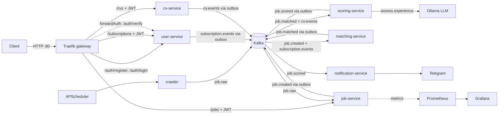

# job-hunter


An event-driven microservice system that collects job postings, normalizes and deduplicates them, matches them against user subscriptions, scores the fit between a user's CV and each job, and delivers notifications over Telegram. Built with Python, FastAPI, Kafka, PostgreSQL, Traefik and a locally hosted LLM (Ollama).

## Architecture



| Component | Responsibility | Owns |
|---|---|---|
| traefik | Single entry point, routing, JWT check via forwardAuth, upload size limit | - |
| crawler | Fetches postings on a schedule and publishes them, almost unmodified, to `job.raw` | - |
| job-service | Normalizes salary and skills, deduplicates across sources, serves the search API, publishes `job.created` | `jobs` database |
| user-service | Registration, login (JWT), job-search subscriptions, token verification for the gateway | `users` database |
| cv-service | Accepts a CV (PDF, DOCX, TXT), extracts text, masks contact details, publishes `cv.events` | `cvs` database |
| matching-service | Keeps a local copy of subscriptions, filters each new job against them, publishes `job.matched` | `matching` database |
| scoring-service | Keeps a local copy of CVs, scores the CV-to-job fit, publishes `job.scored` | `scoring` database |
| notification-service | Delivers scored matches to Telegram, drops duplicate deliveries | `notifications` database |
| ollama | Runs the local LLM used by scoring-service | model volume |

Each service owns its database. Services never read each other's data; they only exchange events.

## Kafka topics

| Topic | Producer | Consumer |
|---|---|---|
| `job.raw` | crawler | job-service |
| `job.created` | job-service | matching-service |
| `subscription.events` | user-service | matching-service |
| `cv.events` | cv-service | scoring-service |
| `job.matched` | matching-service | scoring-service |
| `job.scored` | scoring-service | notification-service |
| `job.raw.dlq`, `matching.dlq`, `scoring.dlq`, `notification.dlq` | the consuming services | (manual inspection) |

## How the fit score works

A hard filter (the user's subscription) runs first, so only jobs that already satisfy the criteria cost an LLM call. Then scoring-service computes:

- **Skill overlap**, by code: skills found in the CV versus skills found in the job (keyword matching).
- **Experience judgment**, by the LLM: given the full CV and job description, is the experience `below`, `meets` or `exceeds` what the job asks? Output is constrained to a JSON schema and validated again in code.
- **Score** = 70 x skill ratio + 30 x experience value (below 0.3, meets 0.8, exceeds 1.0).

If the LLM is down or returns unusable output, the score falls back to skills only and the notification says so. A user without a CV still receives notifications, without a score. See [ADR-0004](docs/adr/0004-hybrid-cv-job-scoring.md) for why the LLM is not asked to produce the whole score.

## Key engineering points

- **Event-driven with Kafka (KRaft):** services are decoupled; `job.raw` can be replayed to reprocess data after changing normalization logic.
- **API gateway:** Traefik is the only public entry point. Routes are Docker labels; protected routes call user-service (`forwardAuth`) so JWT validation lives in one place and internal service ports are not published.
- **Transactional Outbox** in job-service, user-service, cv-service, matching-service and scoring-service: a state change and its event are written in one transaction, so events are not lost when Kafka is unavailable (at-least-once delivery).
- **Event-carried state:** matching-service and scoring-service keep their own copies of subscriptions and CVs, built from events, so they never call other services at runtime.
- **Idempotent consumers:** duplicates are dropped by composite primary keys (matching, scoring) and by `event_id` (notification).
- **Hybrid LLM scoring:** facts are computed by code, the LLM only makes a bounded judgment, and its output is schema-constrained, validated, and optional (graceful fallback).
- **Prompt-injection hardening:** CV and job text are passed as delimited data, delimiter tags are stripped from them, and the model can only return two constrained fields.
- **Cross-source deduplication:** the same job from several sources is stored once; its origins live in `job_sources`.
- **Dead-letter topics:** failing messages are retried a limited number of times (data errors are not retried), then moved to a DLQ with the error and original position in headers.
- **Observability:** Prometheus metrics and a Grafana dashboard provisioned from files.
- **Versioned migrations:** Alembic in every service with a database.
- **CI:** GitHub Actions runs the tests and builds the image of every service.

## Getting started

Requirements: Docker and Docker Compose, and about 4 GB of free RAM for the LLM. The scoring step is slow without a GPU (minutes per match on 2 vCPUs).

```bash
git clone git@github.com:ten-cua-ban/job-hunter.git
cd job-hunter
docker compose up -d postgres kafka
scripts/init-databases.sh
scripts/init-topics.sh
docker compose up -d --build
docker compose exec ollama ollama pull qwen2.5:3b
```

Until the model is pulled, scoring falls back to skills only.

Run the end-to-end demo (without a chat id, notifications are only logged):

```bash
scripts/demo.sh                 # dry-run
scripts/demo.sh <telegram-chat-id>
```

To send real Telegram messages, create a bot with @BotFather, send it a message, and put the token in `.env`:

```
TELEGRAM_BOT_TOKEN=<your token>
```

then `docker compose up -d notification-service`. Never commit `.env`.

| Component | URL |
|---|---|
| API gateway (all API calls) | http://localhost |
| job-service Swagger UI | http://localhost/docs/jobs |
| user-service Swagger UI | http://localhost/docs/users |
| cv-service Swagger UI | http://localhost/docs/cvs |
| Traefik dashboard (dev only, unauthenticated) | http://localhost:8081 |
| Kafka UI | http://localhost:8080 |
| Prometheus | http://localhost:9090 |
| Grafana (admin / admin) | http://localhost:3000 |

## Using the API

Every call goes through the gateway on port 80. `/jobs`, `/subscriptions` and `/cvs` require a JWT.

```bash
# register and log in
curl -X POST localhost/auth/register -H 'Content-Type: application/json' \
  -d '{"email":"me@example.com","password":"secret123"}'
TOKEN=$(curl -s -X POST localhost/auth/login -H 'Content-Type: application/json' \
  -d '{"email":"me@example.com","password":"secret123"}' \
  | python3 -c 'import sys,json; print(json.load(sys.stdin)["access_token"])')

# upload a CV (PDF, DOCX or TXT, max 2 MB); uploading again replaces it
curl -X PUT localhost/cvs/me -H "Authorization: Bearer $TOKEN" -F "file=@cv.pdf"

# search jobs
curl -H "Authorization: Bearer $TOKEN" "localhost/jobs?q=python&skills=docker&limit=5"

# subscribe to matching jobs
curl -X POST localhost/subscriptions -H "Authorization: Bearer $TOKEN" -H 'Content-Type: application/json' \
  -d '{"skills":["python","kafka"],"location":"remote","min_salary":1000,"currency":"usd","telegram_chat_id":"<chat id>"}'
```

Requests without a valid token get `401` from the gateway and never reach the service. Service ports are not published; `/metrics`, `/health` and `/auth/verify` are only reachable inside the Docker network.

## Tests

```bash
docker compose run --rm -v "$PWD/services/job-service":/srv job-service \
  sh -c "pip install -q -r requirements-dev.txt && pytest -v"
```

Replace `job-service` (twice) with another service name to test it. Scoring tests use a fake LLM, so they do not need Ollama.

## Design decisions

- [ADR-0001: Kafka over RabbitMQ](docs/adr/0001-kafka-over-rabbitmq.md)
- [ADR-0002: Transactional Outbox](docs/adr/0002-transactional-outbox.md)
- [ADR-0003: Traefik as API gateway with forwardAuth](docs/adr/0003-traefik-gateway-with-forward-auth.md)
- [ADR-0004: Hybrid CV-to-job scoring](docs/adr/0004-hybrid-cv-job-scoring.md)

## Privacy notes

- Only the extracted text of a CV is stored; the uploaded file is discarded.
- Emails, phone numbers and URLs are replaced with placeholders before the text is stored or published. **Names and addresses are not detected**, so this is not anonymization.
- The redacted CV text is kept in cv-service's database, copied into scoring-service's database, and published on `cv.events`. Deleting a CV emits `cv.deleted`, but earlier `cv.updated` messages stay in Kafka until the topic's retention period ends.
- The LLM runs locally, so CV text is not sent to a third party.

## Security notes and known limitations

- `/auth/verify` only checks the JWT signature and expiry, so a token stays valid until it expires even if the user is deleted.
- Internal services trust the gateway (including the `X-User-Id` header): they are safe only because their ports are not published.
- Traefik reads the Docker socket (read-only) and its dashboard runs with `api.insecure`; both are development shortcuts. There is no TLS yet.
- Secrets in `docker-compose.yml` (database password, JWT secret) are development defaults. The Ollama image uses the `latest` tag.
- Scoring weights (70/30, 0.3/0.8/1.0) are hand-picked and not validated against labelled data. Keyword-based skill detection misses synonyms and skills outside the list.
- The skill list is duplicated in job-service and scoring-service and can drift; the outbox code is duplicated across five services. Both would normally become a shared library.
- LLM scoring is slow on CPU and processes one match at a time, so notifications can be delayed when many jobs match at once.
- Scanned (image-only) PDFs are rejected; there is no OCR.
- Only one data source (RemoteOK). A new source is a single new file in `services/crawler/app/sources/`.
- matching-service scans all active subscriptions for every job, and jobs are not re-matched against a subscription created later.
- Full-text search uses the `simple` configuration, so Vietnamese text is only partially supported.
- A wrong Telegram token sends every notification to the DLQ instead of stopping the consumer.
- No replay tooling for the dead-letter topics yet.
- Planned: a minimum-score threshold on subscriptions, rate limiting at the gateway, a hosted-LLM option.
